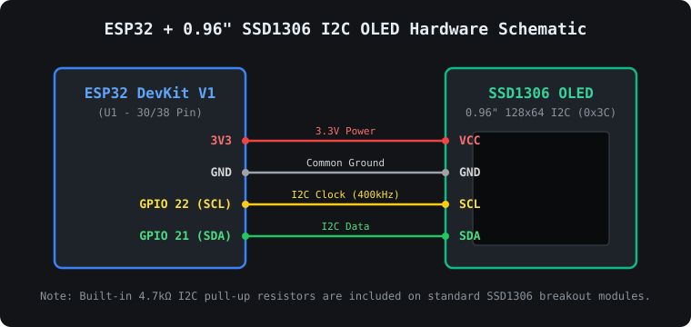

# ESP32 Wi-Fi Synced Lyrics & Live OLED Display

A real-time desktop media bridge that captures system-wide playback from **YouTube Music**, **Spotify**, or any browser on Windows via the native Windows Media Control API (`winsdk`), fetches time-synced `.lrc` lyrics, and streams them over Wi-Fi to an **ESP32 + 0.96" SSD1306 I2C OLED display**.



---

## Features

- **Zero-Lag Native Media Bridge**: Reads track metadata and playback state directly from Windows GSMTC (`winsdk`) without needing browser extensions.
- **Multi-Provider Synced Lyrics**: Queries Musixmatch, LRCLIB, and NetEase via `syncedlyrics` with automatic fallback to title/artist display.
- **Drift-Free Monotonic Clock & Non-Blocking Wi-Fi**: Runs HTTP POST updates on background threads and uses a continuous monotonic stopwatch to prevent mid-song freezing.
- **Smooth Pixel Scrolling & Custom UI**:
  - Top row displays the **active lyric line**; bottom row previews the **upcoming lyric line**.
  - 700ms initial reading hold before smooth 1px-step scrolling begins.
  - Dedicated right-hand sidebar with a pulsing heart animation and 3-band audio equalizer.
- **Built-in Web Controller**: Hosts an AJAX web portal at `http://<ESP32_IP>/` to manually push custom messages to the OLED without page reloads.

---

## Repository Structure

```text
ESP32-OLED-Synced-Lyrics/
├── firmware/
│   └── esp32_oled_lyrics/
│       └── esp32_oled_lyrics.ino      # ESP32 Arduino sketch (SSD1306 OLED + WebServer)
├── pc_bridge/
│   ├── music_sync.py                  # Windows Python media & synced lyrics streamer
│   └── requirements.txt               # Python dependencies
├── hardware/
│   ├── schematic.svg                  # Visual wiring diagram
│   └── kicad/
│       ├── esp32_oled_lyrics.kicad_pro # KiCad project file
│       └── esp32_oled_lyrics.kicad_sch # KiCad 7/8 schematic file
├── .gitignore
└── README.md
```

---

## Hardware & Wiring (KiCad Schematic Included)

Open `hardware/kicad/esp32_oled_lyrics.kicad_sch` in **KiCad 7.0+** to view or modify the schematic.

| 0.96" SSD1306 OLED Pin | ESP32 DevKit V1 Pin | Description |
| :--- | :--- | :--- |
| **VCC** | **3V3** | 3.3V Power Supply |
| **GND** | **GND** | Common Ground |
| **SCL** | **GPIO 22** | I2C Clock (`Wire` default SCL @ 400kHz) |
| **SDA** | **GPIO 21** | I2C Data (`Wire` default SDA) |

---

## Setup & Installation

### 1. Flash the ESP32 Firmware

1. Open `firmware/esp32_oled_lyrics/esp32_oled_lyrics.ino` in **Arduino IDE**.
2. Install the required libraries via **Sketch -> Include Library -> Manage Libraries**:
   - `Adafruit SSD1306`
   - `Adafruit GFX Library`
3. Update your Wi-Fi credentials at the top of the sketch:
   ```cpp
   const char* ssid = "YOUR_WIFI_SSID";
   const char* password = "YOUR_WIFI_PASSWORD";
   ```
4. Select your ESP32 board and COM port, then click **Upload**.
5. Upon boot, the OLED will display its local IP address (e.g., `192.168.1.21`) for **10 seconds**.

### 2. Run the PC Python Bridge

1. Install **Python 3.10+** on Windows.
2. Install the required packages:
   ```powershell
   cd pc_bridge
   python -m pip install -r requirements.txt
   ```
3. Open `pc_bridge/music_sync.py` and set `ESP32_IP` to the IP address shown on your OLED screen:
   ```python
   ESP32_IP = os.getenv("ESP32_IP", "192.168.1.21")
   ```
4. Run the script:
   ```powershell
   python music_sync.py
   ```
5. Play any track on **YouTube Music**, **Spotify**, or your browser—synced lyrics will stream automatically!

---

## Fine-Tuning

- **Scroll Speed**: Change `scrollInterval` (default `55` ms) in `esp32_oled_lyrics.ino` to adjust how fast long lines scroll across the OLED.
- **Lyric Sync Offset**: Adjust `SYNC_OFFSET_SECONDS` (default `0.5` seconds) in `music_sync.py` to advance or delay lyric transitions.
